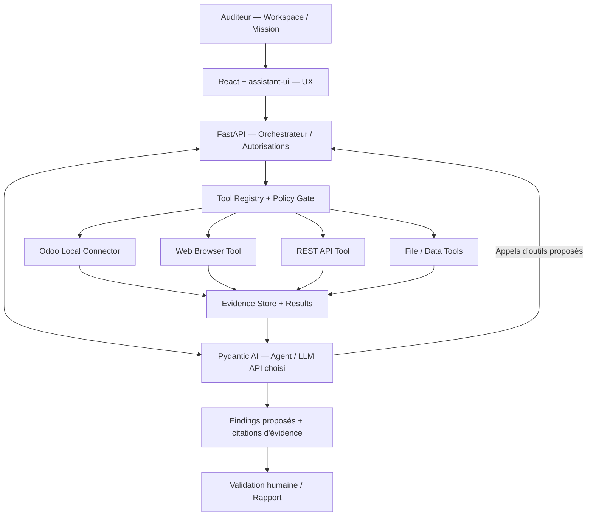

# AuditLens V1 — Dossier de conception complet

> **AI-assisted, evidence-driven IT audit laboratory** — dossier de travail pour construire un **projet étudiant MGSI × AI Engineering**.  
> Date de cadrage : **12 novembre 2026**. **Statut : spécification / conception, non preuve de code implémenté.**

## L'idée en une phrase

AuditLens donne à un **auditeur SI** un espace où connecter des systèmes autorisés (**Odoo local, application web, API REST**) ou importer des fichiers (**CSV, Excel, JSON**), définir une mission, laisser un **agent LLM via API** utiliser des **outils réels** pour collecter et contrôler des preuves, puis **examiner des constats traçables** avant un rapport.

## Ce que nous construisons — et ne construisons pas

- **V1 comprend impérativement** : connecteur ERP **Odoo local**, inspection **Web**, inspection **API REST**, analyse **fichiers structurés**, **un seul moteur IA** et **Tool Harness**, findings documentés, interface React moderne.
- **L'IA est centrale dans l'investigation et l'explication** ; elle ne remplace pas les calculs déterministes, les contrôles sûrs, ni la validation de l'auditeur.
- **L'agent n'est pas omnipotent** : chaque audit a un périmètre, des droits, des capacités et des preuves disponibles.
- **Pas de produit SaaS à vendre**, pas d'audit exhaustif universel, pas de certification de conformité automatique, pas d'entraînement de grand LLM local.
- **3D société / vue isométrique** : objectif UX visuel, indépendant de la fiabilité des contrôles ; pas une source de vérité.

## Point décisif — modèle gratuit / OpenCode / BYOK

- **OpenCode** est un agent/client de codage utilisable pour **développer AuditLens**, avec des modèles gratuits proposés *dans OpenCode* sous conditions et selon disponibilité.
- **Les modèles free-tier chat d'OpenCode Console sont réservés à OpenCode** : leur `Inference API` **refuse les autres clients (HTTP 403)**. Ne pas coder AuditLens en supposant que son backend FastAPI peut les appeler gratuitement. Sources : https://opencode.ai/docs/console/api/inference et https://opencode.ai/docs/console/models.
- Pour **tester l'app sans dépenser** : `MockLLM` pour vérifier les outils ; puis **API réellement utilisable via un éventuel free tier du fournisseur** (quotas à revérifier), ou clé personnelle/quelques crédits.
- Pour un **utilisateur final** : **BYOK (Bring Your Own Key)** pour `OpenAI`, `Gemini`, `Claude`, `DeepSeek` et d'autres fournisseurs compatibles si testés ; aucun fournisseur imposé.
- Compatibilité `OpenAI-compatible` **≠** garantie du même niveau de support pour `tool calls`, `JSON schema`, `streaming` et paramètres : tests d'intégration par modèle requis.

## Navigation (à lire dans cet ordre)

| Fichier | Contenu |
|---|---|
| [RUNBOOK.md](RUNBOOK.md) | **▶ Exécuter l'application implémentée** (backend + frontend + démo) |
| [docs/22_RAPPORT_TESTS_REELS.md](docs/22_RAPPORT_TESTS_REELS.md) | **Rapport de tests réels ERP/API/Web** : détections, problèmes → corrections, limites |
| [docs/CONTRAT_API_IMPL.md](docs/CONTRAT_API_IMPL.md) | Contrat d'API réel du backend |
| [docs/21_ADR_IMPL_V1.md](docs/21_ADR_IMPL_V1.md) | ADR d'implémentation (choix confirmés/ajustés) |
| [01_VISION_PERIMETRE.md](docs/01_VISION_PERIMETRE.md) | But, limites, valeur ajoutée, scope V1 |
| [02_UX_AUDITEUR.md](docs/02_UX_AUDITEUR.md) | Parcours utilisateur, pages, actions, affichage des tools |
| [03_ARCHITECTURE.md](docs/03_ARCHITECTURE.md) | Diagrammes, modules, communications |
| [04_ALGORITHME_AGENT.md](docs/04_ALGORITHME_AGENT.md) | Boucle d'investigation et conditions d'arrêt |
| [05_HARNESS_TOOLS.md](docs/05_HARNESS_TOOLS.md) | Contrats des outils et garde-fous |
| [06_CONNECTEURS.md](docs/06_CONNECTEURS.md) | Architecture multi-sources |
| [07_ODOO_LOCAL.md](docs/07_ODOO_LOCAL.md) | ERP connecté V1 et audit métier |
| [08_WEB_API.md](docs/08_WEB_API.md) | Navigateurs / API, tests et preuve |
| [09_IMPORTS_DONNEES.md](docs/09_IMPORTS_DONNEES.md) | CSV / Excel / JSON / XML différé |
| [10_LLM_FOURNISSEURS_BYOK.md](docs/10_LLM_FOURNISSEURS_BYOK.md) | OpenAI / Gemini / Claude / DeepSeek, OpenCode et BYOK |
| [11_AUDIT_CONTROLES.md](docs/11_AUDIT_CONTROLES.md) | Méthodologie, contrôles, constats, prudence |
| [12_DONNEES_SIMULATION.md](docs/12_DONNEES_SIMULATION.md) | Jeux de tests inédits, ground truth, générateur |
| [13_SECURITE.md](docs/13_SECURITE.md) | Permissions, SSRF, secrets, prompt injection |
| [14_MODELE_DONNEES_API.md](docs/14_MODELE_DONNEES_API.md) | Entités, endpoints et objets JSON exemples |
| [15_STACK_ADR.md](docs/15_STACK_ADR.md) | Choix techniques et alternatives |
| [16_GITHUB_REFERENCES.md](docs/16_GITHUB_REFERENCES.md) | Répos inspectés, usage, licences |
| [17_EVALUATION.md](docs/17_EVALUATION.md) | Mesures et tests d'acceptation |
| [18_PLAN_DEVELOPPEMENT.md](docs/18_PLAN_DEVELOPPEMENT.md) | Répartition, vertical slice, étapes |
| [19_UX_DESIGN_SYSTEM.md](docs/19_UX_DESIGN_SYSTEM.md) | Design visuel, animations, société 3D |
| [20_GLOSSAIRE.md](docs/20_GLOSSAIRE.md) | Définitions MGSI/AI et terminologie |
| [AGENTS.md](AGENTS.md) | Instructions à donner à Codex / OpenCode |

## Diagramme central

## Définition de succès

Une mission sur des **données inédites** utilise des outils autorisés, produit des faits vérifiables, distingue soupçon et anomalie démontrée, et permet à l'auditeur de reproduire/contester chaque constat. Un beau dashboard n'est pas une preuve de réussite.

### العربية — توضيح مختصر

المشروع أداة مساعدة للـ <code>Auditeur SI</code>، ماشي منصة تدّعي أنها قادرة تدقق جميع الأنظمة وحدها. نسخة <code>V1</code> خاصها تدعم <code>Odoo Local</code> و<code>REST API</code> و<code>Web App</code> وملفات البيانات، والـ <code>AI Harness</code> ينفّذ أدوات حقيقية ويعطي نتائج مرتبطة بأدلة مع مراجعة بشرية. النماذج المجانية داخل <code>OpenCode</code> ما نعتابروهاش <code>API</code> مجانية لتطبيقنا؛ والمستخدم يقدر يربط المفتاح ديالو حسب المزود.

## Sources supportées (stabilisation 2026-11)

- **Fichiers structurés** : CSV, XLSX, **JSON first-class** (racines tableau/objet+tableau/objet/primitif, imbrication aplatie en chemins pointés `a.b.c`, JSONL accepté ; bornes 10 Mo / 100k lignes / profondeur 12).
- **Odoo générique read-only** : tous les modèles métier lisibles par le compte d'audit (standards + customs) via `odoo_list_models` / `odoo_describe_model` / `odoo_query_records` / `odoo_follow_relation` / `odoo_aggregate_records`. Modèles techniques/sensibles (ir.*, tokens, credentials) et champs binaires refusés. Les outils spécialisés (réconciliation commandes/factures/stock/achats) restent disponibles.
- **REST APIs** : endpoints déclarés + inspection de contrat OpenAPI.
- **Web** : parcours Playwright prédéfinis.

## Démarche de démonstration

1. `cd backend && uv run uvicorn app.main:app --port 8000` — vérifier `GET /api/reports` => 200 (sinon serveur stale : voir RUNBOOK).
2. `cd frontend && npm run dev` → http://localhost:5173/chat
3. Chat : « inspecte la source orders.json » → carte Source Intelligence.
4. « Audite cette source et vérifie le contrat » → plan LLM, tools, preuves, constats, revue humaine.
5. « Compare qty et delivered sur l'evidence de validation » → table interactive avec incohérences surlignées.
6. Panel Investigation : Hypothèses / Couverture / Différentiel / Remédiation (transitions humaines).
